# 基于springboot的影城会员管理系统ih133

> 🎓 **计算机毕业设计 · 基于springboot的影城会员管理系统ih133**
>
> 本仓库只放**项目介绍 + 运行截图**（截图是站点带水印的原图，存在仓库 `images/` 里）。
>
> 👉 **完整可运行源码 / 数据库脚本 / 部署文档：[点我获取](https://geekcode.top/archives/%E5%9F%BA%E4%BA%8Espringboot%E7%9A%84%E5%BD%B1%E5%9F%8E%E4%BC%9A%E5%91%98%E7%AE%A1%E7%90%86%E7%B3%BB%E7%BB%9Fih133?utm_source=github)**
>
> 💬 咨询微信：**ir9372**　|　🌐 更多项目：[极客代码 geekcode.top](https://geekcode.top/?utm_source=github)
>
> 📌 项目详情页：<https://geekcode.top/archives/%E5%9F%BA%E4%BA%8Espringboot%E7%9A%84%E5%BD%B1%E5%9F%8E%E4%BC%9A%E5%91%98%E7%AE%A1%E7%90%86%E7%B3%BB%E7%BB%9Fih133?utm_source=github>

<table><td width="230" align="center"> <b>扫码加微信 ir9372</b></td><td valign="middle">📦 源码 = 项目介绍 + 全部运行截图 + 数据库 + 部署文档 👉 点上方任意截图，直接跳到 <b>极客代码 geekcode.top</b> 详情页</td></table>

---

<h1>基于springboot的影城会员管理系统_ih133</h1>
<h2>项目概述</h2>

本项目旨在构建一个基于 Spring Boot 框架的影城会员管理系统，以解决传统影院在会员管理、票务信息展示及商品销售方面的数字化需求。系统采用前后端分离架构（Vue-Integrated），核心功能涵盖电影信息展示、影院商品管理、会员卡服务、挂失处理、在线评论互动及后台综合管理。适用人群主要为影院运营人员及普通会员用户。技术架构上，后端选用 Spring Boot 结合 MyBatis-Plus 实现高效数据持久化，利用 Shiro 框架保障系统安全与权限控制；前端通过 Vue 生态集成页面渲染，提供流畅的用户体验。该系统实现了从前台信息浏览到后台业务闭环的全流程管理，提升了影院运营效率与会员服务质量。

<h2>技术架构</h2>

本系统采用经典的分层架构设计，确保代码的可维护性与扩展性。

<strong>1. 后端架构</strong>

<ul>
<li><strong>核心框架</strong>：使用 <code>spring-boot-starter-web</code> 作为基础 Web 容器，简化配置并快速启动服务。</li>
<li><strong>数据持久层</strong>：集成 <code>mybatis-spring-boot-starter</code> 和 <code>mybatis-plus</code>，利用 MyBatis-Plus 提供的通用 CRUD 接口大幅减少样板代码，同时支持复杂 SQL 查询。数据库连接驱动为 <code>mysql-connector-java</code>。</li>
<li><strong>安全认证</strong>：引入 <code>shiro-spring</code> 进行身份验证和授权管理，确保只有具备相应权限的用户才能访问敏感接口或后台模块。</li>
<li><strong>工具组件</strong>：使用 <code>commons-lang3</code> 提供常用工具类，<code>validation-api</code> 用于参数校验，<code>protobuf-java</code> 可能用于特定高性能数据传输场景。</li>
</ul>

<strong>2. 前端架构</strong>

<ul>
<li><strong>类型</strong>：Vue-Integrated 模式。这意味着前端视图层与后端逻辑紧密集成，通常由 Spring Boot 直接托管静态资源或通过模板引擎渲染，而非完全独立的 SPA 应用部署。</li>
<li><strong>交互</strong>：通过 RESTful API 与后端 Controller 进行数据交换，实现动态内容加载。</li>
</ul>

<strong>3. 数据库设计要点</strong>

<ul>
<li>基于 MySQL 关系型数据库存储核心业务数据。</li>
<li>主要实体包括：会员信息 (<code>huiyuan</code>)、电影信息 (<code>dianyingxinxi</code>)、影厅信息 (<code>yingtingxinxi</code>)、影院商品 (<code>yingyuanshangpin</code>)、会员卡 (<code>huiyuanka</code>)、订单 (<code>orders</code>)、评论 (<code>discuss...</code>)、公告 (<code>news</code>) 等。</li>
<li>通过外键关联实现多表查询，如电影分类与电影信息的关联，商品分类与商品的关联。</li>
</ul>

<a href="https://geekcode.top/archives/%E5%9F%BA%E4%BA%8Espringboot%E7%9A%84%E5%BD%B1%E5%9F%8E%E4%BC%9A%E5%91%98%E7%AE%A1%E7%90%86%E7%B3%BB%E7%BB%9Fih133?utm_source=github" title="查看完整源码">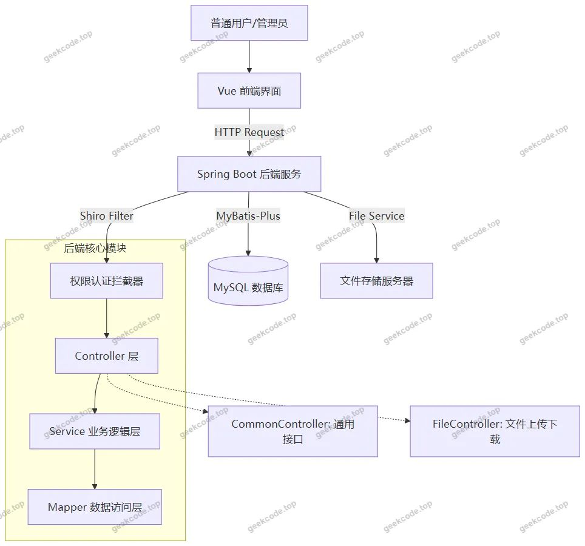</a>

<h2>功能模块</h2>

根据源码中的 Controller 列表及截图功能，系统分为前台用户端和后台管理端两大板块。

<h3>前台用户端</h3>

前台主要面向注册会员和普通访客，提供信息浏览与基础交互功能。

<ol>
<li><strong>首页与导航</strong></li>
</ol>
<ul>
<li>展示轮播图、最新公告及推荐电影/商品入口。</li>
<li>导航菜单包含：首页、电影信息、影院商品、通知公告。</li>
</ul>
<ol start="2">
<li><strong>电影信息服务</strong></li>
</ol>
<ul>
<li><strong>电影列表</strong>：展示所有上映或待映电影的基本信息（名称、海报、简介等）。</li>
<li><strong>电影详情与评论</strong>：查看具体电影详细信息，并可发表文字评论（对应 <code>DiscussdianyingxinxiController</code>）。</li>
<li><strong>电影分类</strong>：按类型筛选电影（对应 <code>DianyingfenleiController</code>）。</li>
</ul>
<ol start="3">
<li><strong>影院商品服务</strong></li>
</ol>
<ul>
<li><strong>商品列表</strong>：展示爆米花、饮料等影院周边商品。</li>
<li><strong>商品详情与评论</strong>：查看商品属性及用户评价（对应 <code>DiscussyingyuanshangpinController</code>）。</li>
<li><strong>商品分类</strong>：按品类筛选商品（对应 <code>ShangpinfenleiController</code>）。</li>
</ul>
<ol start="4">
<li><strong>会员中心与服务</strong></li>
</ol>
<ul>
<li><strong>个人中心</strong>：显示用户基本信息、收藏列表等。</li>
<li><strong>会员卡管理</strong>：查看持有的会员卡状态、余额等信息（对应 <code>HuiyuanController</code> 部分逻辑及 <code>Huiyuanka</code> 相关视图）。</li>
<li><strong>挂失申请</strong>：针对丢失的会员卡提交挂失请求（对应 <code>GuashixinxiController</code>）。</li>
</ul>
<ol start="5">
<li><strong>其他功能</strong></li>
</ol>
<ul>
<li><strong>通知公告</strong>：查看影院发布的最新新闻和通知（对应 <code>/news</code> 路由）。</li>
<li><strong>关于我们</strong>：展示影院介绍及联系方式（对应 <code>AboutusController</code>）。</li>
<li><strong>在线咨询</strong>：提供实时聊天窗口，方便用户咨询客服（对应 <code>ChatController</code>）。</li>
</ul>
<h3>后台管理端</h3>

后台面向影院管理员，提供全量数据的增删改查及业务审核功能。

<ol>
<li><strong>系统管理</strong></li>
</ol>
<ul>
<li><strong>登录页</strong>：管理员身份验证入口。</li>
<li><strong>后台首页</strong>：展示关键数据统计概览。</li>
<li><strong>系统简介</strong>：编辑“关于我们”及系统基础配置信息（对应 <code>Systemintro</code> 路由及 <code>ConfigController</code>）。</li>
<li><strong>轮播图管理</strong>：配置前台首页展示的轮播广告图片。</li>
</ul>
<ol start="2">
<li><strong>会员与卡务管理</strong></li>
</ol>
<ul>
<li><strong>会员管理</strong>：注册新会员、修改会员信息、删除会员、查询会员列表（对应 <code>HuiyuanController</code>）。</li>
<li><strong>会员卡管理</strong>：发行、激活、冻结、注销会员卡，查看卡内余额及有效期（对应 <code>Huiyuanka</code> 路由）。</li>
<li><strong>挂失信息管理</strong>：审核和处理用户的会员卡挂失申请（对应 <code>GuashixinxiController</code>）。</li>
</ul>
<ol start="3">
<li><strong>内容与业务管理</strong></li>
</ol>
<ul>
<li><strong>电影信息管理</strong>：录入电影详情、设置放映时间、关联影厅、上下架操作（对应 <code>DianyingxinxiController</code>）。</li>
<li><strong>影厅信息管理</strong>：维护影厅名称、座位数、设施描述等（对应 <code>Yingtingxinxi</code> 路由）。</li>
<li><strong>电影分类管理</strong>：定义和维护电影的类型标签（对应 <code>DianyingfenleiController</code>）。</li>
<li><strong>影院商品管理</strong>：上架/下架商品，设置价格、库存、图片（对应 <code>Yingyuanshangpin</code> 路由）。</li>
<li><strong>商品分类管理</strong>：定义和维护商品类别（对应 <code>Shangpinfenlei</code> 路由）。</li>
<li><strong>通知公告管理</strong>：发布、编辑、删除前台显示的新闻公告（对应 <code>News</code> 路由）。</li>
</ul>
<ol start="4">
<li><strong>互动与交易管理</strong></li>
</ol>
<ul>
<li><strong>订单管理</strong>：查看所有用户下单记录，处理订单状态（对应 <code>/orders/:status</code> 路由）。</li>
<li><strong>评论管理</strong>：审核和管理用户对电影 (<code>Discussdianyingxinxi</code>) 和商品 (<code>Discussyingyuanshangpin</code>) 的评论内容，支持删除违规评论。</li>
<li><strong>在线咨询管理</strong>：查看和处理用户发起的聊天会话记录（对应 <code>ChatController</code>）。</li>
</ul>
<h2>用户角色与权限</h2>

基于 Shiro 框架的安全机制，系统主要划分两类角色：

<ol>
<li><strong>超级管理员 (Admin)</strong></li>
</ol>
<ul>
<li><strong>权限范围</strong>：拥有最高权限，可访问后台所有路由 (<code>/admin/*</code>)。</li>
<li><strong>功能职责</strong>：</li>
<li>全权管理会员数据、会员卡发行与状态变更。</li>
<li>维护基础数据字典（电影分类、商品分类、影厅信息）。</li>
<li>发布与管理前台展示内容（电影、商品、公告、轮播图）。</li>
<li>审核用户提交的挂失申请及处理异常订单。</li>
<li>管理用户评论，维护社区秩序。</li>
<li>配置系统参数及查看在线咨询记录。</li>
</ul>
<ol start="2">
<li><strong>普通会员/注册用户 (User)</strong></li>
</ol>
<ul>
<li><strong>权限范围</strong>：仅能访问前台页面及部分个人中心功能，无法进入后台管理系统。</li>
<li><strong>功能职责</strong>：</li>
<li>浏览电影、商品、公告等公开信息。</li>
<li>对电影和商品发表评论。</li>
<li>查看个人收藏、个人信息。</li>
<li>管理自己的会员卡状态，发起挂失申请。</li>
<li>参与在线咨询。</li>
<li>创建订单（购买会员权益或商品，具体取决于业务逻辑，此处依据“订单管理”存在推断）。</li>
</ul>

<em>注：源码中未明确体现“教师”、“学生”等非影院特有角色，故仅列出上述两种典型角色。</em>

<h2>项目特色与创新点</h2>
<ol>
<li>
<strong>一体化会员生命周期管理</strong>
   系统不仅关注会员的基础信息录入，还深度集成了“会员卡”与“挂失”功能模块。通过 <code>Huiyuanka</code> 和 <code>Guashixinxi</code> 的联动，实现了从发卡、充值、消费到异常处理（挂失）的完整闭环，解决了传统系统中卡片状态更新滞后的痛点。

</li>
<li>
<strong>双向互动社区机制</strong>
   引入了 <code>Discussdianyingxinxi</code> 和 <code>Discussyingyuanshangpin</code> 两个独立的评论模块，分别针对文化产品（电影）和实物产品（商品）建立反馈渠道。配合后台的评论管理功能，形成了“用户评价-商家审核-信息透明”的信任机制，增强了用户粘性。

</li>
<li>
<strong>实时在线客服集成</strong>
   通过 <code>ChatController</code> 实现在线咨询功能，打破了传统表单留言的低效沟通壁垒。管理员可在后台直接响应前台用户的疑问，提升了服务响应速度和用户体验满意度。

</li>
<li>
<strong>基于 Shiro 的细粒度安全控制</strong>
   相较于简单的 Session 过滤，采用 Apache Shiro 框架使得权限控制更加灵活和安全。能够精确区分前台匿名浏览、登录用户操作以及后台管理员特权，有效防止越权访问和数据泄露风险。

</li>
<li>
<strong>高效的开发运维架构</strong>
   采用 Spring Boot + MyBatis-Plus 组合，极大减少了 XML 映射文件的编写工作量，通过注解和继承 BaseMapper 即可实现大部分 CRUD 操作，降低了代码冗余度，提高了系统的可维护性和迭代速度。

</li>
</ol>
<h2>部署环境</h2>

为确保系统正常运行，需准备以下软硬件环境：

<ol>
<li><strong>操作系统</strong></li>
</ol>
<ul>
<li>Windows 7/10/11, Linux (CentOS 7+, Ubuntu 18.04+), macOS。</li>
</ul>
<ol start="2">
<li><strong>Java 运行环境</strong></li>
</ol>
<ul>
<li>JDK 版本：建议 JDK 1.8 或 JDK 11（Spring Boot 2.x 兼容标准）。</li>
<li>环境变量配置：正确设置 <code>JAVA_HOME</code> 和 <code>PATH</code>。</li>
</ul>
<ol start="3">
<li><strong>数据库</strong></li>
</ol>
<ul>
<li>MySQL Server：版本 5.7 或 8.0。</li>
<li>需要创建对应的数据库实例，并导入项目提供的 <code>.sql</code> 初始化脚本以生成表结构及初始数据。</li>
</ul>
<ol start="4">
<li><strong>Web 服务器/中间件</strong></li>
</ol>
<ul>
<li>内置 Tomcat：由于是 Spring Boot 项目，通常无需单独安装外部 Tomcat，jar 包内嵌即可运行。若部署为 war 包，则需 Tomcat 8.5+。</li>
</ul>
<ol start="5">
<li><strong>前端依赖 (视具体打包方式而定)</strong></li>
</ol>
<ul>
<li>Node.js：若前端 Vue 代码需独立编译打包，需安装 Node.js (LTS 版本) 和 npm/yarn。</li>
<li>若为 <code>vue-integrated</code> 且直接引用 CDN 或预编译静态资源，则仅需浏览器支持 ES6+。</li>
</ul>
<ol start="6">
<li><strong>浏览器</strong></li>
</ol>
<ul>
<li>Chrome, Edge, Firefox, Safari 等现代主流浏览器，用于访问前台和后台界面。</li>
</ul>
<ol start="7">
<li><strong>开发工具 (可选，用于二次开发)</strong></li>
</ol>
<ul>
<li>IDE：IntelliJ IDEA 或 Eclipse。</li>
<li>数据库客户端：Navicat 或 DBeaver。</li>
</ul>
<h2>五、技术特性</h2>
<ul>
<li>前后端集成部署，前端资源打包至后端 static 目录</li>
<li>使用 MyBatis-Plus 简化数据访问层开发</li>
<li>集成 Shiro 权限框架实现角色权限控制</li>
</ul>
<h2>六、功能模块截图</h2>
<h3>前台用户端</h3>
<h4>前台-电影分类列表</h4>

<a href="https://geekcode.top/archives/%E5%9F%BA%E4%BA%8Espringboot%E7%9A%84%E5%BD%B1%E5%9F%8E%E4%BC%9A%E5%91%98%E7%AE%A1%E7%90%86%E7%B3%BB%E7%BB%9Fih133?utm_source=github" title="查看完整源码">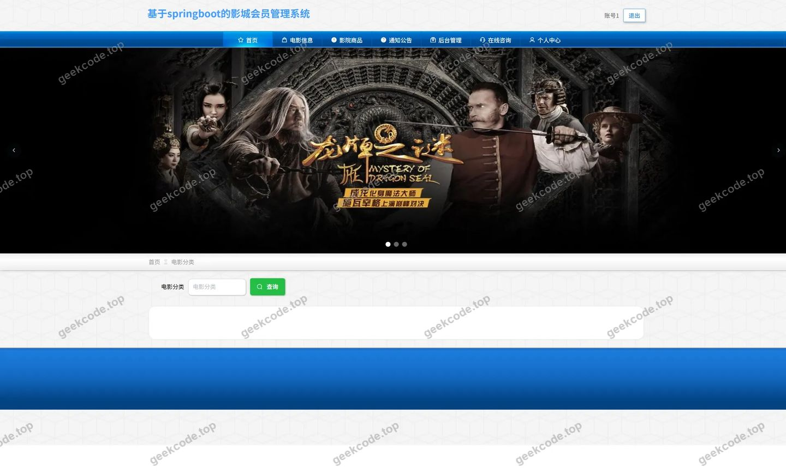</a>

<h4>前台-电影信息列表</h4>

<h4>前台-挂失信息列表</h4>

<h4>前台-会员卡列表</h4>

<a href="https://geekcode.top/archives/%E5%9F%BA%E4%BA%8Espringboot%E7%9A%84%E5%BD%B1%E5%9F%8E%E4%BC%9A%E5%91%98%E7%AE%A1%E7%90%86%E7%B3%BB%E7%BB%9Fih133?utm_source=github" title="查看完整源码">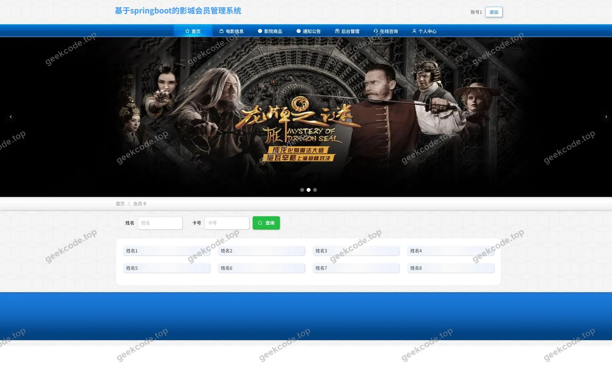</a>

<h4>前台-商品分类列表</h4>

<h4>前台-收藏列表</h4>

<a href="https://geekcode.top/archives/%E5%9F%BA%E4%BA%8Espringboot%E7%9A%84%E5%BD%B1%E5%9F%8E%E4%BC%9A%E5%91%98%E7%AE%A1%E7%90%86%E7%B3%BB%E7%BB%9Fih133?utm_source=github" title="查看完整源码">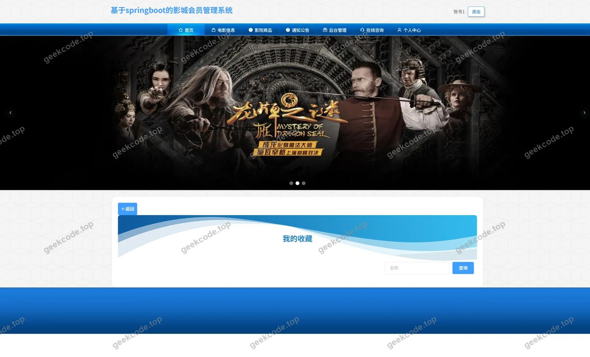</a>

<h4>前台-影厅信息列表</h4>

<h4>前台-影院商品列表</h4>

<a href="https://geekcode.top/archives/%E5%9F%BA%E4%BA%8Espringboot%E7%9A%84%E5%BD%B1%E5%9F%8E%E4%BC%9A%E5%91%98%E7%AE%A1%E7%90%86%E7%B3%BB%E7%BB%9Fih133?utm_source=github" title="查看完整源码">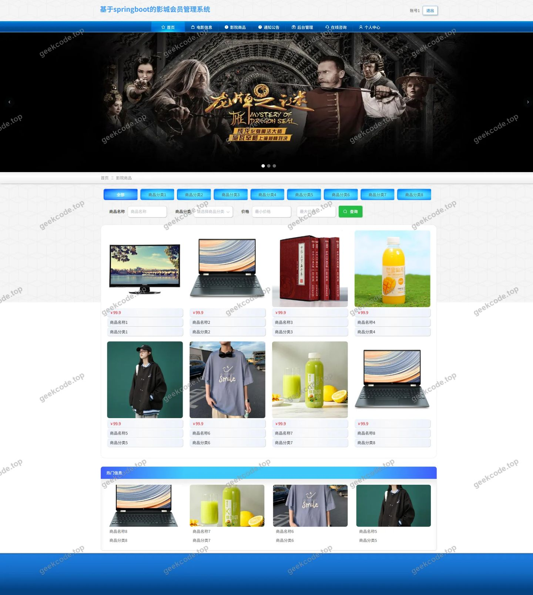</a>

<h4>前台-个人中心</h4>

<a href="https://geekcode.top/archives/%E5%9F%BA%E4%BA%8Espringboot%E7%9A%84%E5%BD%B1%E5%9F%8E%E4%BC%9A%E5%91%98%E7%AE%A1%E7%90%86%E7%B3%BB%E7%BB%9Fih133?utm_source=github" title="查看完整源码">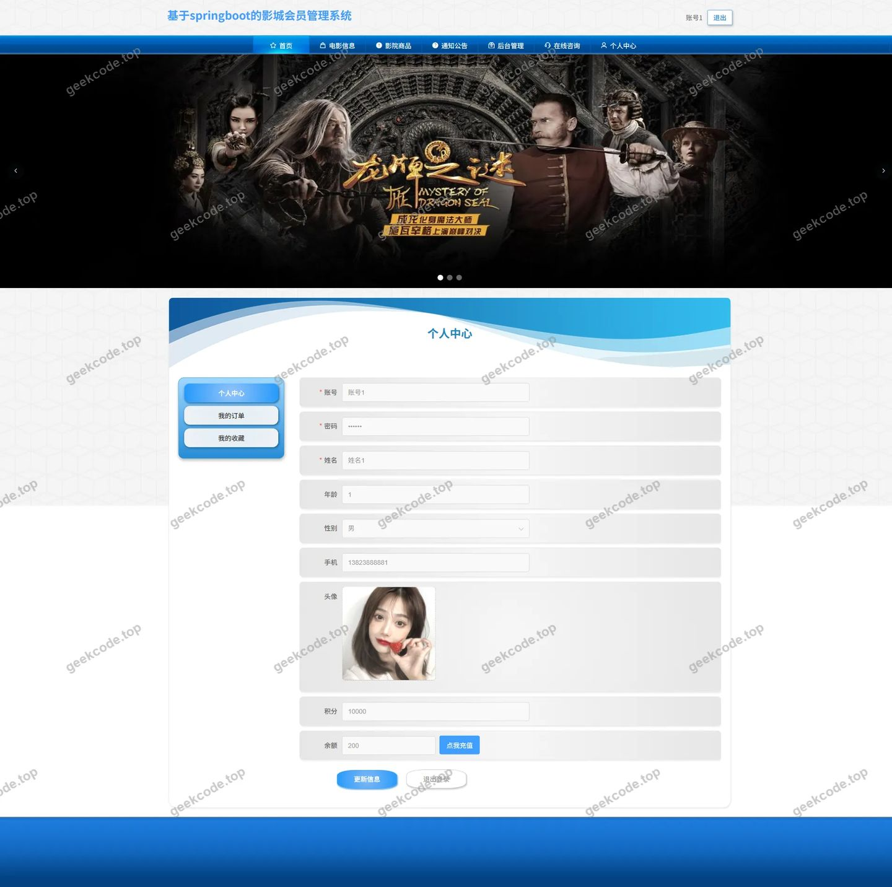</a>

<h4>前台-公告列表</h4>

<a href="https://geekcode.top/archives/%E5%9F%BA%E4%BA%8Espringboot%E7%9A%84%E5%BD%B1%E5%9F%8E%E4%BC%9A%E5%91%98%E7%AE%A1%E7%90%86%E7%B3%BB%E7%BB%9Fih133?utm_source=github" title="查看完整源码">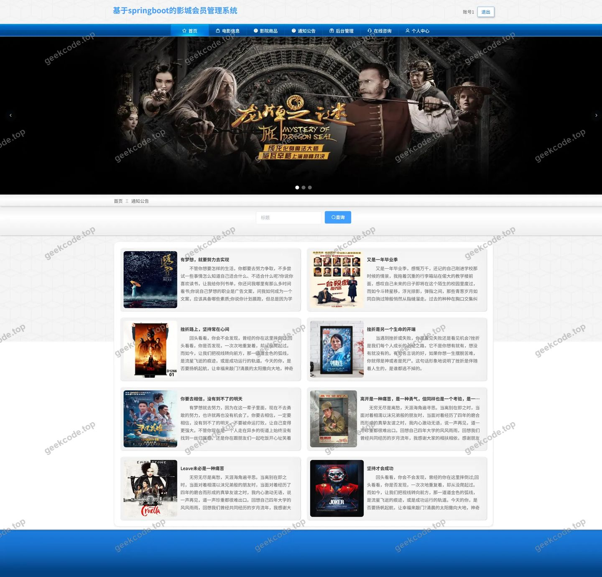</a>

<h3>后台管理端</h3>
<h4>后台-关于我们</h4>

<a href="https://geekcode.top/archives/%E5%9F%BA%E4%BA%8Espringboot%E7%9A%84%E5%BD%B1%E5%9F%8E%E4%BC%9A%E5%91%98%E7%AE%A1%E7%90%86%E7%B3%BB%E7%BB%9Fih133?utm_source=github" title="查看完整源码">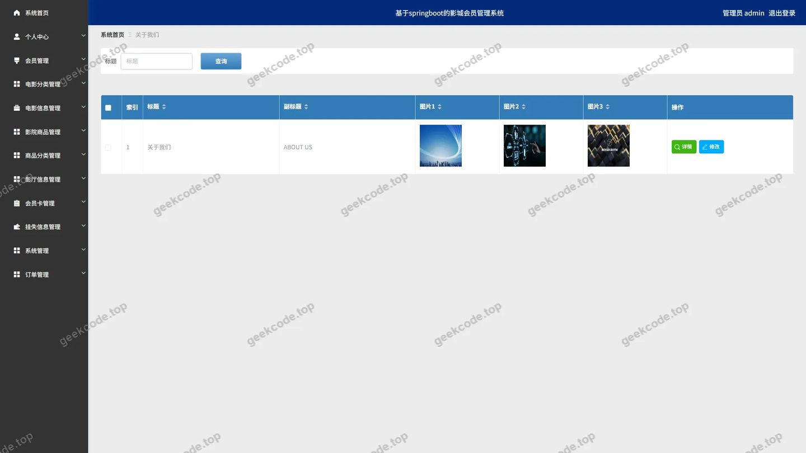</a>

<h4>后台-在线客服</h4>

<a href="https://geekcode.top/archives/%E5%9F%BA%E4%BA%8Espringboot%E7%9A%84%E5%BD%B1%E5%9F%8E%E4%BC%9A%E5%91%98%E7%AE%A1%E7%90%86%E7%B3%BB%E7%BB%9Fih133?utm_source=github" title="查看完整源码">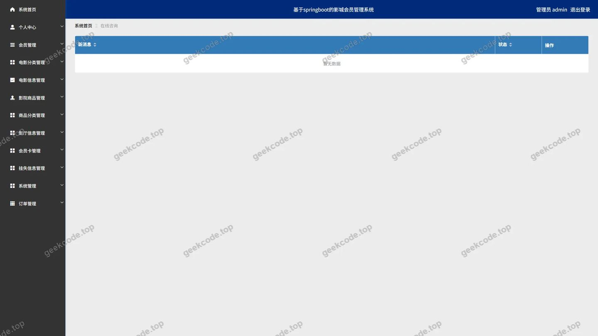</a>

<h4>后台-系统配置</h4>

<a href="https://geekcode.top/archives/%E5%9F%BA%E4%BA%8Espringboot%E7%9A%84%E5%BD%B1%E5%9F%8E%E4%BC%9A%E5%91%98%E7%AE%A1%E7%90%86%E7%B3%BB%E7%BB%9Fih133?utm_source=github" title="查看完整源码">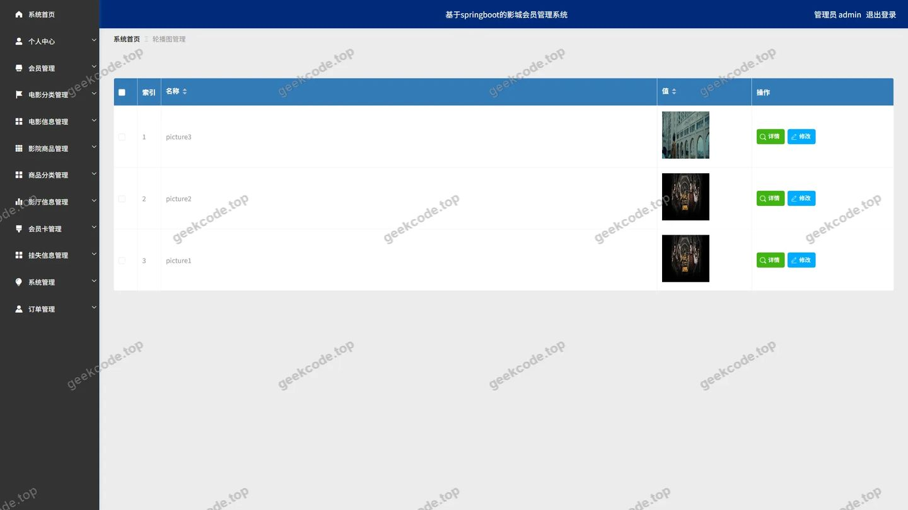</a>

<h4>后台-电影分类</h4>

<a href="https://geekcode.top/archives/%E5%9F%BA%E4%BA%8Espringboot%E7%9A%84%E5%BD%B1%E5%9F%8E%E4%BC%9A%E5%91%98%E7%AE%A1%E7%90%86%E7%B3%BB%E7%BB%9Fih133?utm_source=github" title="查看完整源码">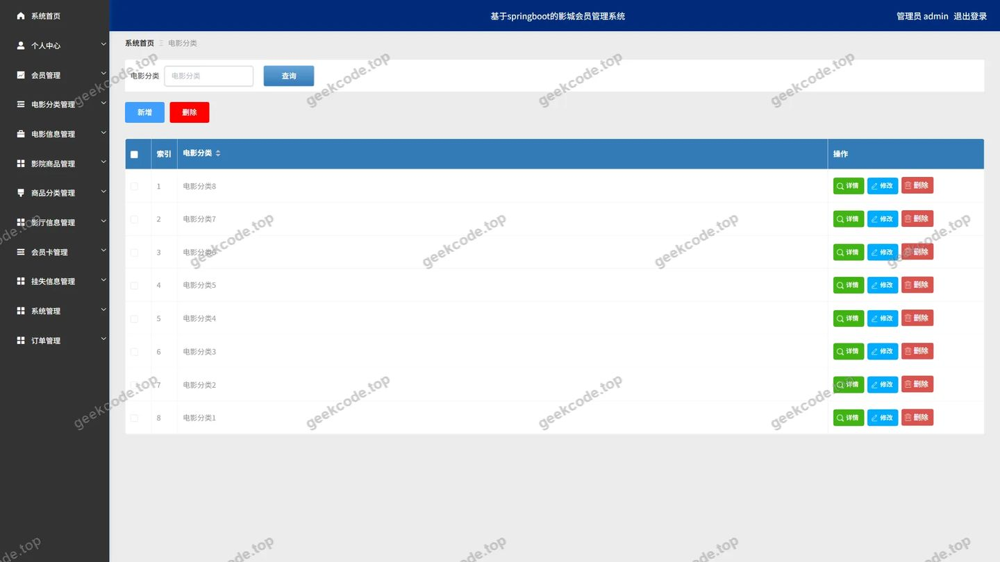</a>

<h4>后台-电影信息</h4>

<a href="https://geekcode.top/archives/%E5%9F%BA%E4%BA%8Espringboot%E7%9A%84%E5%BD%B1%E5%9F%8E%E4%BC%9A%E5%91%98%E7%AE%A1%E7%90%86%E7%B3%BB%E7%BB%9Fih133?utm_source=github" title="查看完整源码">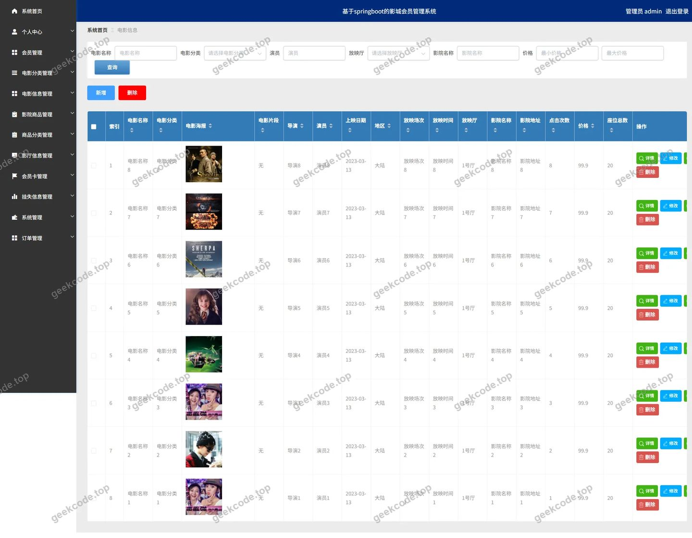</a>

<h4>后台-电影信息评论</h4>

<h4>后台-影院商品评论</h4>

<a href="https://geekcode.top/archives/%E5%9F%BA%E4%BA%8Espringboot%E7%9A%84%E5%BD%B1%E5%9F%8E%E4%BC%9A%E5%91%98%E7%AE%A1%E7%90%86%E7%B3%BB%E7%BB%9Fih133?utm_source=github" title="查看完整源码">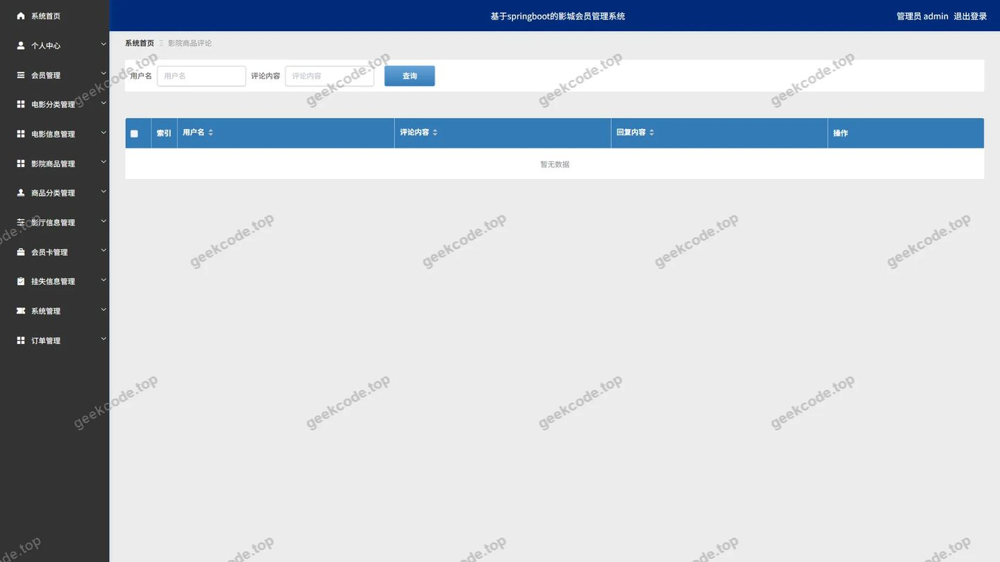</a>

<h4>后台-挂失信息</h4>

<a href="https://geekcode.top/archives/%E5%9F%BA%E4%BA%8Espringboot%E7%9A%84%E5%BD%B1%E5%9F%8E%E4%BC%9A%E5%91%98%E7%AE%A1%E7%90%86%E7%B3%BB%E7%BB%9Fih133?utm_source=github" title="查看完整源码">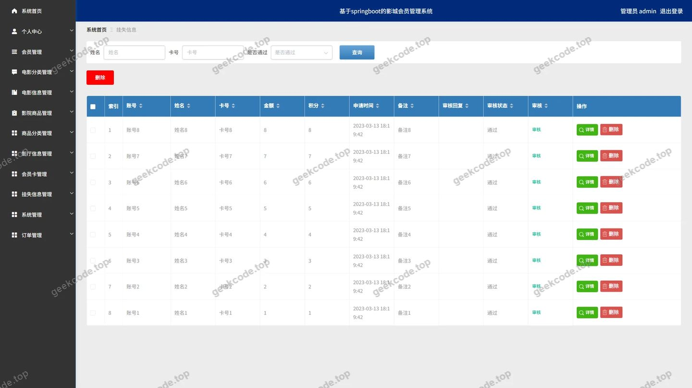</a>

<h4>后台首页</h4>

<a href="https://geekcode.top/archives/%E5%9F%BA%E4%BA%8Espringboot%E7%9A%84%E5%BD%B1%E5%9F%8E%E4%BC%9A%E5%91%98%E7%AE%A1%E7%90%86%E7%B3%BB%E7%BB%9Fih133?utm_source=github" title="查看完整源码">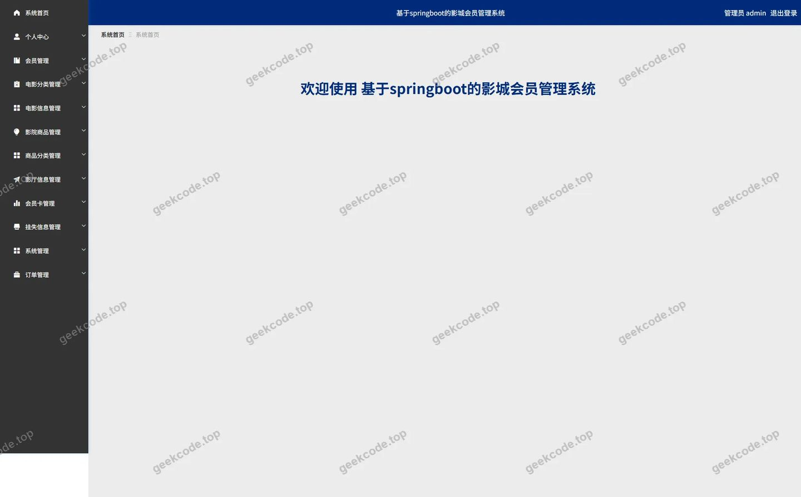</a>

<h4>后台-会员</h4>

<a href="https://geekcode.top/archives/%E5%9F%BA%E4%BA%8Espringboot%E7%9A%84%E5%BD%B1%E5%9F%8E%E4%BC%9A%E5%91%98%E7%AE%A1%E7%90%86%E7%B3%BB%E7%BB%9Fih133?utm_source=github" title="查看完整源码">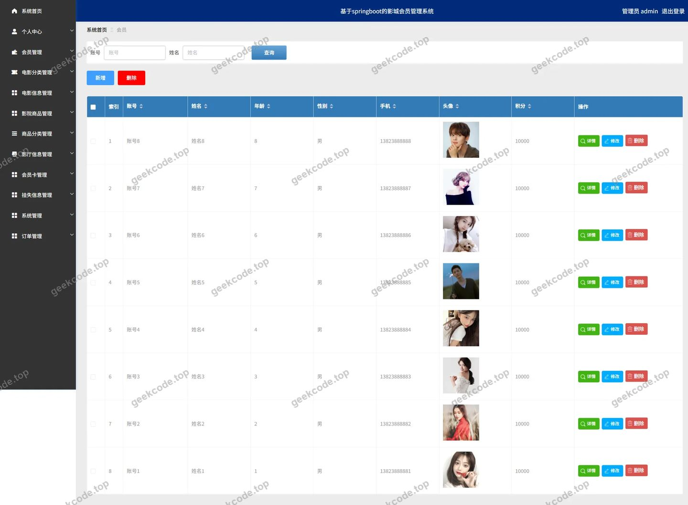</a>

<h4>后台-会员卡</h4>

<a href="https://geekcode.top/archives/%E5%9F%BA%E4%BA%8Espringboot%E7%9A%84%E5%BD%B1%E5%9F%8E%E4%BC%9A%E5%91%98%E7%AE%A1%E7%90%86%E7%B3%BB%E7%BB%9Fih133?utm_source=github" title="查看完整源码">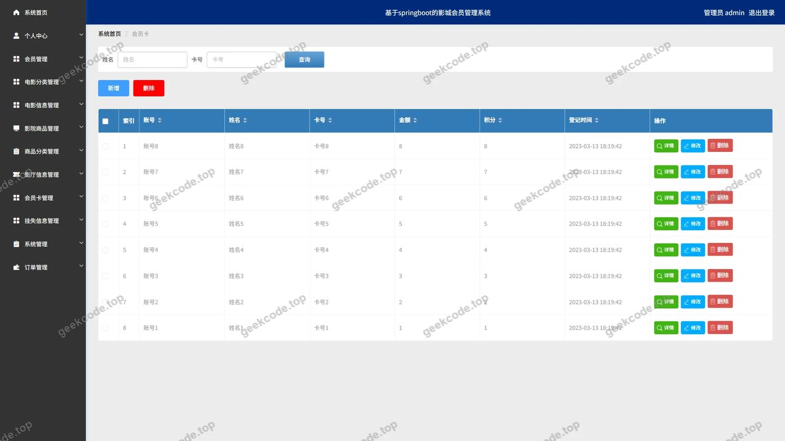</a>

<h4>后台-登录</h4>

<h4>后台-公告信息</h4>

<a href="https://geekcode.top/archives/%E5%9F%BA%E4%BA%8Espringboot%E7%9A%84%E5%BD%B1%E5%9F%8E%E4%BC%9A%E5%91%98%E7%AE%A1%E7%90%86%E7%B3%BB%E7%BB%9Fih133?utm_source=github" title="查看完整源码">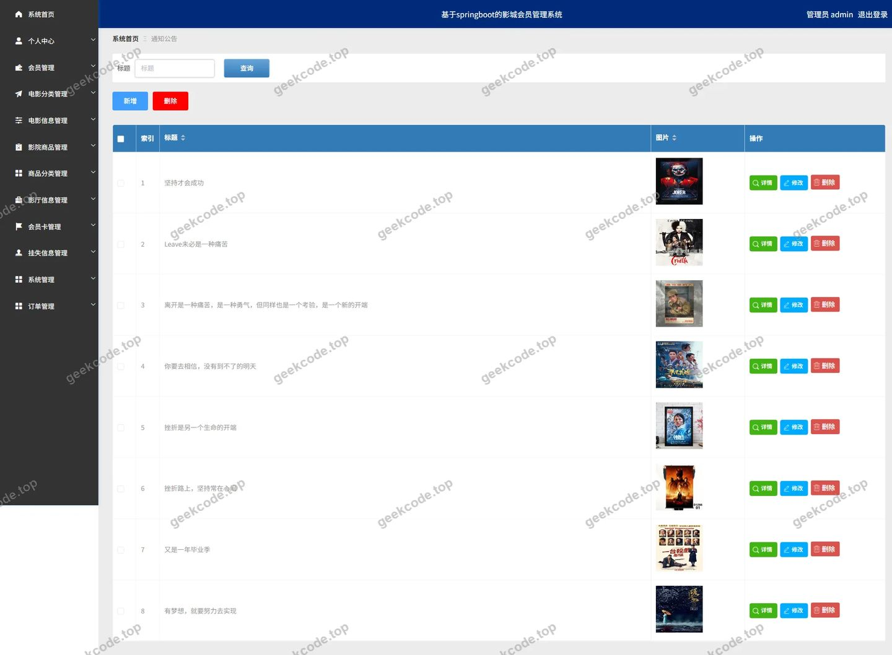</a>

<h4>后台-订单-状态</h4>

<a href="https://geekcode.top/archives/%E5%9F%BA%E4%BA%8Espringboot%E7%9A%84%E5%BD%B1%E5%9F%8E%E4%BC%9A%E5%91%98%E7%AE%A1%E7%90%86%E7%B3%BB%E7%BB%9Fih133?utm_source=github" title="查看完整源码">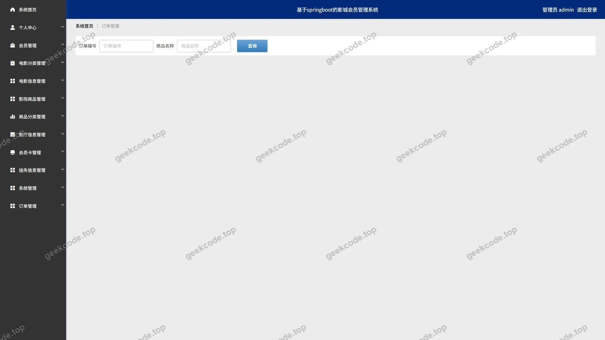</a>

<h4>后台-商品分类</h4>

<h4>后台-影厅信息</h4>

<a href="https://geekcode.top/archives/%E5%9F%BA%E4%BA%8Espringboot%E7%9A%84%E5%BD%B1%E5%9F%8E%E4%BC%9A%E5%91%98%E7%AE%A1%E7%90%86%E7%B3%BB%E7%BB%9Fih133?utm_source=github" title="查看完整源码">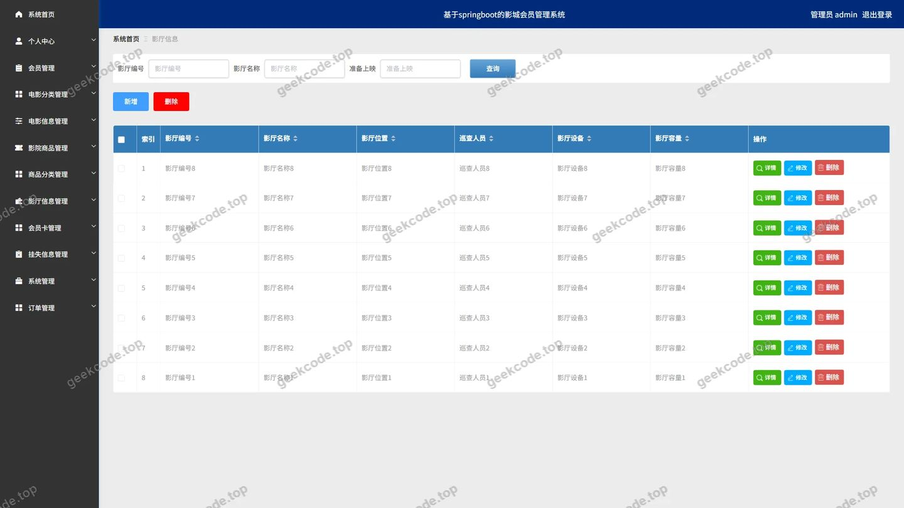</a>

<h4>后台-影院商品</h4>

<a href="https://geekcode.top/archives/%E5%9F%BA%E4%BA%8Espringboot%E7%9A%84%E5%BD%B1%E5%9F%8E%E4%BC%9A%E5%91%98%E7%AE%A1%E7%90%86%E7%B3%BB%E7%BB%9Fih133?utm_source=github" title="查看完整源码">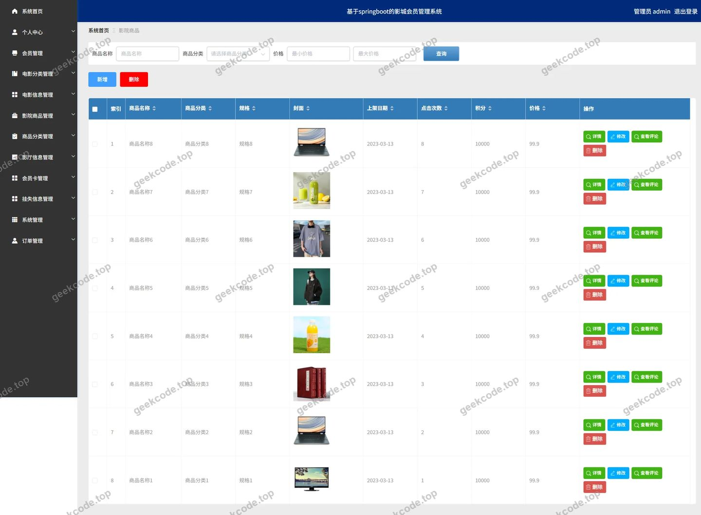</a>

---

## 获取完整源码

| 项目 | 说明 |
| --- | --- |
| 项目名 | 基于springboot的影城会员管理系统ih133 |
| 运行截图 | 本文 28 张（站点带水印原图，仓库 `images/` 目录） |
| 完整源码 | [https://geekcode.top/archives/%E5%9F%BA%E4%BA%8Espringboot%E7%9A%84%E5%BD%B1%E5%9F%8E%E4%BC%9A%E5%91%98%E7%AE%A1%E7%90%86%E7%B3%BB%E7%BB%9Fih133?utm_source=github](https://geekcode.top/archives/%E5%9F%BA%E4%BA%8Espringboot%E7%9A%84%E5%BD%B1%E5%9F%8E%E4%BC%9A%E5%91%98%E7%AE%A1%E7%90%86%E7%B3%BB%E7%BB%9Fih133?utm_source=github) |
| 咨询微信 | **ir9372**（备注：jingpin-yuanma） |
| 更多项目 | [极客代码 geekcode.top](https://geekcode.top/?utm_source=github) |

> 需要源码、部署、改配置、跑不起来等问题，加微信 ir9372 沟通，说明项目名即可。
